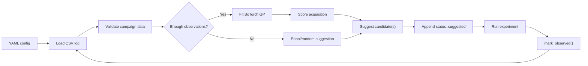

# 🧪 BO Forge v3.4.3

BO Forge helps you run Bayesian optimisation campaigns for real experiments.
You describe the variables, objectives, and constraints in a YAML config and keep
every suggestion and result in a CSV log. BO Forge fits BoTorch Gaussian-process
models to the observed rows and suggests what to try next. The same `bo_forge`
package drives the notebook API (`CampaignSession`), the `bo-forge` CLI, and a
local Streamlit workbench. An experimental FastAPI probe is also included.

**New here? [Start here](START_HERE.md)** to download BO Forge and open the local
Streamlit interface, with no Git experience required.

## ✨ What's New

**v3.4.3** adds [supported public Python typing](https://github.com/angzeli/bo-forge/blob/main/docs/PUBLIC_API.md#supported-public-python-typing)
for the top-level exports, public configuration records, session methods,
exceptions, and result records, with a `py.typed` marker. No runtime, BO,
YAML/CSV schema, or CLI behavior changes.

**On `main`, not yet released:** Python 3.14 support and campaign-log write
hardening. See the [CHANGELOG](https://github.com/angzeli/bo-forge/blob/main/CHANGELOG.md) for these and every earlier release.

---

## ✅ What BO Forge Supports

BO Forge deliberately supports only:

- continuous, integer, discrete, and categorical variables
- single-objective campaigns, plus coupled multi-objective campaigns with `m >= 2` objectives
- maximize or minimize direction
- Sobol or random initial suggestions
- BoTorch `SingleTaskGP` and `SingleTaskMultiFidelityGP`
- optional single-objective model profiles: `default`, `smooth`, `rough`, and `robust`
- LogEI/qLogEI and qLogNEI for supported single-objective campaigns, qMFKG for conservative single-objective multi-fidelity campaigns, and qLogEHVI/qLogNEHVI for coupled multi-objective campaigns
- CSV campaign logs
- optional feasibility constraints
- optional cost-aware ranking and human review
- optional replicate tracking, replicate-derived observation variance, and replicate-aware aggregation
- optional structured/staged campaign logs with stage-aware validation, explicit stage-aware suggestions, and read-only stage diagnostics
- optional single-objective multi-fidelity qMFKG with one continuous fidelity variable, optional ordered numeric levels, batches of one through four, and read-only fidelity coverage/progress diagnostics
- optional single-objective contextual LogEI/qLogEI with context variables fixed at suggestion time, including review, deterministic cost, and replicate combinations
- resume from existing logs
- basic diagnostics, model diagnostics, model-profile comparison plots, Pareto-front plots, and hypervolume progress
- a notebook-first `CampaignSession` workflow
- a small `bo-forge` CLI workflow
- a local Streamlit workbench
- an internal app service layer that delegates BO behavior to `CampaignSession`
- an optional experimental FastAPI probe with preferred server-managed staging
  for local/trusted-network exploration
- coordinated append, review, and observation writes across local processes
- optional provenance-managed campaigns with config/log hashes and mutation lineage

Some feature combinations are intentionally unsupported, for example
non-default model profiles outside standard single-objective campaigns,
cost-aware qLogNEI, multi-objective multi-fidelity, learned noise or cost models,
database-backed storage, and a production multi-user web backend. See the
[capability matrix](https://github.com/angzeli/bo-forge/blob/main/docs/CAPABILITY_MATRIX.md) for every supported,
read-only, rejected, and deferred combination. The primary tested multi-objective range is `2 <= m <= 4`; larger objective counts are advanced usage because qLogEHVI/qLogNEHVI, non-dominated partitioning, hypervolume, and visualization become more expensive.

---

## 🧰 Install

BO Forge is not published on PyPI. Install a tagged GitHub release as shown
below; replace `v3.4.3` with another tag to pin a different release.

Install the backend package and CLI:

```bash
pip install "bo-forge @ git+https://github.com/angzeli/bo-forge@v3.4.3"
```

Install the local Streamlit workbench:

```bash
pip install "bo-forge[app] @ git+https://github.com/angzeli/bo-forge@v3.4.3"
```

Install the experimental API probe:

```bash
pip install "bo-forge[api] @ git+https://github.com/angzeli/bo-forge@v3.4.3"
```

For local development from a clone:

```bash
python3.12 -m venv .venv
./.venv/bin/python -m pip install "uv==0.11.3"
./.venv/bin/uv pip install --python ./.venv/bin/python \
  --require-hashes -r requirements/constraints-py312-macos-arm64.txt
./.venv/bin/uv pip install --python ./.venv/bin/python \
  --no-deps --no-build-isolation -e .
```

Choose the generated constraint file matching your interpreter and platform;
Linux CPU environments also pass `--torch-backend cpu`. See
[`requirements/README.md`](https://github.com/angzeli/bo-forge/blob/main/requirements/README.md).

Check the installed version and environment:

```bash
bo-forge --version
bo-forge doctor
```

Launch the packaged local app:

```bash
bo-forge-app
```

The app module entrypoint is also supported:

```bash
python -m bo_forge_app
```

For trusted LAN access:

```bash
bo-forge-app --host 0.0.0.0 --port 8501 --allow-network-access
```

BO Forge has no built-in authentication. Use network access only on a trusted
LAN, VPN, SSH tunnel, or externally authenticated reverse proxy. See
[docs/STREAMLIT_DEPLOYMENT.md](https://github.com/angzeli/bo-forge/blob/main/docs/STREAMLIT_DEPLOYMENT.md)
before sharing the app beyond one local machine.

On macOS, you can create an optional double-click launcher:

```bash
bo-forge-app --make-launcher ~/Desktop/BO-Forge.command
```

Launch the experimental API probe:

```bash
bo-forge-api --root . --host 127.0.0.1 --port 8765
```

Server-managed API stages are held in memory for 30 minutes by default. Limits
can be changed for one launcher process:

```bash
bo-forge-api --root . --stage-ttl-seconds 1800 --max-staged-batches 128
```

Network binds require explicit acknowledgement:

```bash
bo-forge-api --root . --host 0.0.0.0 --port 8765 --allow-network-access
```

Trusted deployments can require server-managed append and disable interactive
API documentation:

```bash
bo-forge-api --root . --server-stages-only --no-docs
```

For API clients, server-managed staging is preferred. The API probe has no
built-in authentication and is not a production backend.
API clients can list active or terminal stage metadata and explicitly renew a
file-valid active stage; reads never extend a stage lifetime automatically.
Stages disappear when the API process restarts, and stage IDs are not
authentication credentials. The earlier client-carried staged-bundle append
path remains available as a trusted-client compatibility workflow.
See [docs/API_PROBE.md](https://github.com/angzeli/bo-forge/blob/main/docs/API_PROBE.md)
and [docs/API_SECURITY.md](https://github.com/angzeli/bo-forge/blob/main/docs/API_SECURITY.md)
before using it beyond localhost.

---

## 🔁 Workflow

A campaign is a loop: ask for suggestions, run the experiments, record the
results, and ask again. Start from one of the bundled [`configs/`](https://github.com/angzeli/bo-forge/blob/main/configs)
and adapt it to your variables and objectives.

```bash
# 1. Create a provenance-managed campaign log for your config
bo-forge init-log --config configs/my_campaign.yaml --log work/campaign.csv

# 2. Check the config and log
bo-forge validate --config configs/my_campaign.yaml --log work/campaign.csv --require-provenance

# 3. Generate suggestions and record them as pending rows
bo-forge suggest --config configs/my_campaign.yaml --log work/campaign.csv --append

# 4. Run the experiment, then record its result using the printed row_id
bo-forge mark-observed --config configs/my_campaign.yaml --log work/campaign.csv \
  --row-id ROW_ID --objective-value 0.82

# 5. Check where the campaign stands, then repeat from step 3
bo-forge status --config configs/my_campaign.yaml --log work/campaign.csv
```

`suggest` changes nothing unless you pass `--append`. Inspect a managed
campaign's identity and mutation history with
`bo-forge provenance --config configs/my_campaign.yaml --log work/campaign.csv`.
The [CLI guide](https://github.com/angzeli/bo-forge/blob/main/docs/CLI.md) covers review decisions, costs, reports, plots,
and JSON output.

`init-log` creates both the canonical CSV and
`work/campaign.csv.manifest.json`. Existing CSV campaigns without a manifest
continue unchanged. Move and back up a managed CSV together with its sidecar; schema v1
cannot distinguish a deliberately removed sidecar from a genuine legacy CSV. See
[docs/PROVENANCE.md](https://github.com/angzeli/bo-forge/blob/main/docs/PROVENANCE.md).
If inspection reports a recoverable interrupted transaction, run
`bo-forge provenance-recover` with the current log fingerprint before resuming.
Legacy adoption and schema-v2 migration are explicit preview-and-confirm
operations.



The CLI, the Streamlit app, and the API probe are thin wrappers. BO logic lives
in the backend package, not in notebooks, CLI commands, or app code.

---

## 📦 Bundled Examples

Each example pairs a config with a seed log, and most have a notebook walkthrough.
The [Quickstart](https://github.com/angzeli/bo-forge/blob/main/docs/QUICKSTART.md#-bundled-example-walkthroughs) explains
what each one demonstrates and how to inspect it.

| Feature | Config | Seed log | Notebook |
| --- | --- | --- | --- |
| Continuous-fidelity qMFKG | `configs/15_multi_fidelity_qmfkg.yaml` | `examples/15_multi_fidelity_qmfkg_campaign_log.csv` | `notebooks/15_multi_fidelity_qmfkg_campaign.ipynb` |
| Ordered-discrete and batch qMFKG | `configs/22_discrete_multi_fidelity_qmfkg.yaml` | `examples/22_discrete_multi_fidelity_qmfkg_campaign_log.csv` | `notebooks/22_discrete_multi_fidelity_qmfkg_campaign.ipynb` |
| Contextual LogEI | `configs/16_contextual_logei.yaml` | `examples/16_contextual_logei_campaign_log.csv` | `notebooks/16_contextual_logei_campaign.ipynb` |
| Contextual LogEI with review and cost | `configs/20_contextual_cost_review_logei.yaml` | `examples/20_contextual_cost_review_campaign_log.csv` | `notebooks/20_contextual_cost_review_logei_campaign.ipynb` |
| Contextual LogEI with replicates | `configs/21_contextual_replicate_logei.yaml` | `examples/21_contextual_replicate_campaign_log.csv` | — |
| Model profiles and diagnostics | `configs/17_model_profile_logei.yaml` | `examples/17_model_profile_campaign_log.csv` | `notebooks/17_model_profile_logei_campaign.ipynb` |
| Held-out predictive evaluation | — | synthetic, generated in the notebook | `notebooks/23_predictive_diagnostics.ipynb` |
| qLogNEI with pending suggestions | `configs/18_noisy_pending_qlognei.yaml` | `examples/18_noisy_pending_qlognei_campaign_log.csv` | `notebooks/18_noisy_pending_qlognei_campaign.ipynb` |
| Noisy multi-objective qLogNEHVI | `configs/19_multi_objective_qlognehvi.yaml` | `examples/19_multi_objective_qlognehvi_campaign_log.csv` | — |
| Closed-loop benchmark smoke | — | — | `notebooks/24_closed_loop_benchmarks.ipynb` |

Configs 01–14 cover the basics: maximise and minimise, mixed variables,
constraints, cost-aware review, replicates, multi-objective qLogEHVI, and
structured campaigns. They are listed under Example Configs in the
[Quickstart](https://github.com/angzeli/bo-forge/blob/main/docs/QUICKSTART.md).

---

## 🗂️ Repository Structure

```text
bo-forge/
├── .github/        # required CI and validation-only future tag gate
├── bo_forge/       # reusable backend package
├── bo_forge_app/   # local Streamlit wrapper
├── bo_forge_api/   # optional FastAPI transport package
├── configs/        # YAML campaign configs
├── examples/       # seed CSV logs and runnable scripts
├── notebooks/      # notebook-first campaign workflows and deeper simulated demos
├── reports/        # generated local reports and figures
├── docs/           # quickstart, CLI, schema, troubleshooting, repo guide
├── requirements/   # generated, hashed Python/platform constraints
└── tests/          # pytest coverage
```
---

## 📚 Documentation

- [docs/QUICKSTART.md](https://github.com/angzeli/bo-forge/blob/main/docs/QUICKSTART.md): setup, quickstart commands, session API example, notebooks, and diagnostics.
- [docs/INSTALLATION.md](https://github.com/angzeli/bo-forge/blob/main/docs/INSTALLATION.md): pip install tutorial for core, app, development, wheel, and sdist installs.
- [docs/CLI.md](https://github.com/angzeli/bo-forge/blob/main/docs/CLI.md): terminal workflow and command reference.
- [docs/STREAMLIT_APP.md](https://github.com/angzeli/bo-forge/blob/main/docs/STREAMLIT_APP.md): local Streamlit app setup and workflow.
- [docs/STREAMLIT_DEPLOYMENT.md](https://github.com/angzeli/bo-forge/blob/main/docs/STREAMLIT_DEPLOYMENT.md): safe local, trusted-LAN, SSH/VPN, and authenticated reverse-proxy deployment guidance.
- [docs/API_PROBE.md](https://github.com/angzeli/bo-forge/blob/main/docs/API_PROBE.md): experimental optional FastAPI probe usage and safety model.
- [docs/API_SECURITY.md](https://github.com/angzeli/bo-forge/blob/main/docs/API_SECURITY.md): API assets, trust boundaries, deployment safeguards, and deferred production requirements.
- [docs/PROVENANCE.md](https://github.com/angzeli/bo-forge/blob/main/docs/PROVENANCE.md): managed campaign identity, mutation ledger, recovery, and trust boundary.
- [docs/CAPABILITY_MATRIX.md](https://github.com/angzeli/bo-forge/blob/main/docs/CAPABILITY_MATRIX.md): supported, read-only, rejected, and deferred feature combinations.
- [docs/09_APP_CREATED_CAMPAIGN_TUTORIAL.md](https://github.com/angzeli/bo-forge/blob/main/docs/09_APP_CREATED_CAMPAIGN_TUTORIAL.md): step-by-step tutorial for creating a new campaign inside the app.
- [docs/CLI_ERROR_EXAMPLES.md](https://github.com/angzeli/bo-forge/blob/main/docs/CLI_ERROR_EXAMPLES.md): intentional CLI failures with expected error and hint output.
- [docs/CSV_SCHEMA.md](https://github.com/angzeli/bo-forge/blob/main/docs/CSV_SCHEMA.md): canonical CSV columns, allowed values, blanks, and status transitions.
- [docs/COMMON_ERRORS.md](https://github.com/angzeli/bo-forge/blob/main/docs/COMMON_ERRORS.md): troubleshooting guide for common YAML and CSV errors.
- [docs/PUBLIC_API.md](https://github.com/angzeli/bo-forge/blob/main/docs/PUBLIC_API.md): stable public imports supported by the `bo_forge` package.
- [docs/PREDICTIVE_EVALUATION.md](https://github.com/angzeli/bo-forge/blob/main/docs/PREDICTIVE_EVALUATION.md): held-out model evaluation, uncertainty units, and [acceptance evidence](https://github.com/angzeli/bo-forge/blob/main/docs/PREDICTIVE_EVALUATION.md#acceptance-evidence).
- [docs/BENCHMARKS.md](https://github.com/angzeli/bo-forge/blob/main/docs/BENCHMARKS.md): source-only closed-loop benchmark harness, specs, and recorded results.
- [docs/NOTEBOOK_EXECUTION.md](https://github.com/angzeli/bo-forge/blob/main/docs/NOTEBOOK_EXECUTION.md): source-archive notebook execution assurance.
- [docs/PERFORMANCE_BENCHMARKS.md](https://github.com/angzeli/bo-forge/blob/main/docs/PERFORMANCE_BENCHMARKS.md): same-host startup and suggestion timing evidence.
- [docs/MIGRATION_V3.md](https://github.com/angzeli/bo-forge/blob/main/docs/MIGRATION_V3.md): v3 module facades, UI mapping, API isolation, and figure changes.
- [docs/RELEASE_CHECKLIST.md](https://github.com/angzeli/bo-forge/blob/main/docs/RELEASE_CHECKLIST.md): GitHub and PyPI release checklist.
- [docs/REPOSITORY_STRUCTURE.md](https://github.com/angzeli/bo-forge/blob/main/docs/REPOSITORY_STRUCTURE.md): detailed package layout and development workflow.
- [CONTRIBUTING.md](https://github.com/angzeli/bo-forge/blob/main/CONTRIBUTING.md): constrained development setup and contribution checks.
- [SECURITY.md](https://github.com/angzeli/bo-forge/blob/main/SECURITY.md): supported release and private vulnerability-reporting guidance.
- [requirements/README.md](https://github.com/angzeli/bo-forge/blob/main/requirements/README.md): generated constraint sets and regeneration commands.
- [CHANGELOG.md](https://github.com/angzeli/bo-forge/blob/main/CHANGELOG.md): release history.
- [ROADMAP_V0_TO_V1.md](https://github.com/angzeli/bo-forge/blob/main/docs/roadmap/ROADMAP_V0_TO_V1.md): completed milestones through v1.0.0.
- [ROADMAP_V1_X.md](https://github.com/angzeli/bo-forge/blob/main/docs/roadmap/ROADMAP_V1_X.md): completed v1.x roadmap.
- [ROADMAP_V2_X.md](https://github.com/angzeli/bo-forge/blob/main/docs/roadmap/ROADMAP_V2_X.md): completed v2.x history.
- [ROADMAP_V3_X.md](https://github.com/angzeli/bo-forge/blob/main/ROADMAP_V3_X.md): active v3 baseline.

---

## 📌 Tested Versions

`pyproject.toml` defines broad end-user requirements. Generated, hashed
Python/platform constraint sets under `requirements/` define the reproducible
CI and release-preparation environments.

---

## 👤 Author

Angze Li
